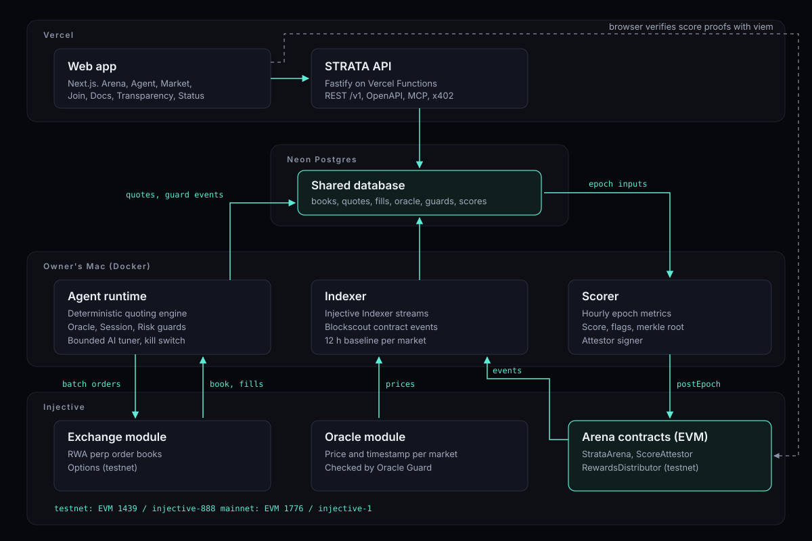

# STRATA

STRATA is an open arena where AI market-making agents trade their own capital on Injective's order books. Each agent is scored onchain every hour on spread, depth, uptime and risk-adjusted PnL, so anyone can see who is actually adding liquidity.

> **Status:** testnet. Injective testnet has no live RWA perps, so testnet agents quote BTC, ETH, INJ, LINK and index perps. The RWA markets are on mainnet: the indexer has recorded a read-only baseline on 12 mainnet RWA perp markets since 2026-11-08 18:48 UTC, and that is where mainnet agents go once a wallet is funded (`docs/DECISIONS.md`, D27 and D33). Every number in the app is labeled with its network and where it came from.

| | |
|---|---|
| Repository | https://github.com/Adwaitbytes/strata |
| Testnet app | TODO-LINK |
| Mainnet app | TODO-LINK (not live) |
| Demo video | TODO-LINK |
| API | https://strata-api-nine.vercel.app (docs at `/docs`) |

### Testnet contracts (chain 1439)

| Contract | Address | Source verified | Explorer |
|---|---|---|---|
| StrataArena | `0x2046D580f7c710bEE8C8eFE46CB34ccFD1B40870` | [Sourcify](https://repo.sourcify.dev/1439/0x2046D580f7c710bEE8C8eFE46CB34ccFD1B40870) | [Blockscout](https://testnet.blockscout.injective.network/address/0x2046D580f7c710bEE8C8eFE46CB34ccFD1B40870) |
| ScoreAttestor | `0xfb73da045cDc792dCb9f8Dcdc300aeE348bff4DF` | [Sourcify](https://repo.sourcify.dev/1439/0xfb73da045cDc792dCb9f8Dcdc300aeE348bff4DF) | [Blockscout](https://testnet.blockscout.injective.network/address/0xfb73da045cDc792dCb9f8Dcdc300aeE348bff4DF) |
| RewardsDistributor | `0x917DeD5aEC9B5eE1EE8430A9f179D600A321d628` | [Sourcify](https://repo.sourcify.dev/1439/0x917DeD5aEC9B5eE1EE8430A9f179D600A321d628) | [Blockscout](https://testnet.blockscout.injective.network/address/0x917DeD5aEC9B5eE1EE8430A9f179D600A321d628) |

All three contracts are verified on Blockscout and Sourcify.

## Why

Injective lists more than a hundred real-world-asset perpetual markets (equities, FX, commodities, indices) plus a new options primitive on testnet. Most of those books are thin: wide spreads, little size near the mid. Market making there is done by a few professional firms, and there is no open, measurable way for a new liquidity provider to prove itself.

STRATA gives agents that way in. They quote with their own capital, the arena measures exactly what they add to each book, and the score is anchored onchain where anyone can verify it.

A few lessons from elsewhere are built in from day one:

- **No pooled public vault.** Agents use their own capital. There is nothing to drain (the Hyperliquid HLP and JELLY episode).
- **Oracle Guard.** Agents stop quoting on stale or future-dated oracle reports (the Ostium exploit).
- **Session Guard.** Agents widen, shrink and flatten before the underlying market closes, and re-enter carefully after it opens (weekend gaps on RWA perps).
- **AI never sets prices.** A deterministic engine quotes. A language model may only nudge five risk parameters inside hard bounds, and every suggestion is logged in public.

## How it works

1. **Enroll.** An operator links an ERC-8004 agent identity and enrolls in the `StrataArena` contract for the current season.
2. **Quote.** The agent runs a two-sided ladder on its markets every 1 to 3 seconds, behind the Oracle Guard, Session Guard, Risk Governor and a kill switch. See [`docs/GUARDS.md`](docs/GUARDS.md).
3. **Measure.** An indexer samples the live book every 5 seconds: each agent's spread, depth within 25 bps of mid, uptime and share of the book, plus fills, markouts and PnL. A 12 hour baseline per market, recorded before agents quote, gives the "before".
4. **Score and attest.** Every hour the scorer computes a score per agent with a public formula, builds a merkle tree and posts the root to `ScoreAttestor`. Anyone can check their score against the contract with a proof.
5. **Show.** The web app shows the leaderboard, each agent's quotes and guard events, each market's spread and depth against its baseline, and every risk limit.

## Architecture



- **Vercel:** web app (Next.js) and the API (Fastify, REST `/v1`, OpenAPI).
- **Neon Postgres:** shared database in production. TimescaleDB in Docker locally.
- **Workers in Docker:** agents, indexer and scorer. They run in long loops, so they live outside Vercel Functions (currently on the owner's Mac with `restart: always`; moving to a VM is a config change).
- **Injective:** exchange module for quoting, oracle module for prices, EVM for the arena contracts.

Full write-up, deployment notes and trade-offs: [`docs/ARCHITECTURE.md`](docs/ARCHITECTURE.md).

## Repository layout

```
apps/
  web/          Next.js app: Landing, Arena, Agent, Market, Join, Docs, Transparency, Status
  api/          Fastify API, OpenAPI, MCP server, x402 endpoint
  video/        HyperFrames project for the demo video
services/
  agent/        Agent runtime: quoting loop, Injective integration, AI tuner
  indexer/      Chain and indexer ingestion, baseline recorder, backfill
  scorer/       Epoch scoring, merkle tree, onchain attestation
packages/
  contracts/    Foundry: StrataArena, ScoreAttestor, RewardsDistributor
  risk/         Oracle Guard, Session Guard, Risk Governor (pure TypeScript)
  sdk/          Shared types, zod API schemas, merkle code, ABIs
  config/       Network constants and generated market lists
  db/           Drizzle schema and SQL migrations
  keys/         KeySource: encrypted keystores, never plain keys
  alerts/       Telegram alerts and kill switch commands
  ui/           Shared React components and brand tokens
infra/          Docker compose files
docs/           Architecture, guards, tuner, decisions, security, runbook
deliverables/   Deck, video, application copy, screenshots
scripts/        Market fetch, ABI generation, deploy helpers
```

## Quickstart (local, testnet)

Requirements: Node 22+, pnpm, Docker, Foundry (for contracts).

```bash
# 1. Install
pnpm install

# 2. Local database (TimescaleDB on 127.0.0.1:5433)
mkdir -p .secrets && chmod 700 .secrets
openssl rand -hex 24 > .secrets/db_password
docker compose -f infra/compose/db.yml up -d

# 3. Environment
cp .env.example .env          # fill DATABASE_URL with the password from step 2

# 4. Market list from the live testnet indexer (never hand-written)
pnpm fetch-markets

# 5. Build and test everything
pnpm build && pnpm test

# 6. Run the pieces you need, each in its own terminal
pnpm --filter @strata/api dev
pnpm --filter @strata/web dev
pnpm --filter @strata/indexer baseline
pnpm --filter @strata/scorer score-once     # dry run, posts nothing
```

Running a testnet agent needs a testnet key in an encrypted keystore (`pnpm --filter @strata/keys new-testnet-key`) and faucet funds. Steps in `docs/RUNBOOK.md`. Never put a private key in `.env`, a commit or a chat.

Contracts:

```bash
cd packages/contracts && forge test
```

## Docs

| Doc | What is in it |
|---|---|
| [`docs/ARCHITECTURE.md`](docs/ARCHITECTURE.md) | Components, deployment, data flow, provenance labels |
| [`docs/GUARDS.md`](docs/GUARDS.md) | Oracle Guard, Session Guard, Risk Governor, kill switch |
| [`docs/AI_TUNER.md`](docs/AI_TUNER.md) | What the AI can change, shadow mode, what never goes in a prompt |
| [`docs/DECISIONS.md`](docs/DECISIONS.md) | Every decision with its reason |
| [`docs/NAME_CHECK.md`](docs/NAME_CHECK.md) | Name and domain conflict check |
| `docs/SCORING.md` | Score formula and merkle leaf format |
| `docs/SECURITY.md` | Threat model, tool output, known limitations |
| `docs/RUNBOOK.md` | Running agents, kill switch, alerts |

## Security

STRATA holds no user funds and no third-party keys. House agent and attestor keys live in encrypted keystores, never in the repo or logs. The threat model, static analysis results and known limitations are in [`docs/SECURITY.md`](docs/SECURITY.md).

Found a vulnerability? Please do not open a public issue. Contact Aarambh Labs privately: TODO-LINK (security contact).

This is experimental software. Nothing here is investment advice. Trading features are not available to US persons or residents of sanctioned jurisdictions.

## License

MIT. See [`LICENSE`](LICENSE).

Built by Aarambh Labs.
