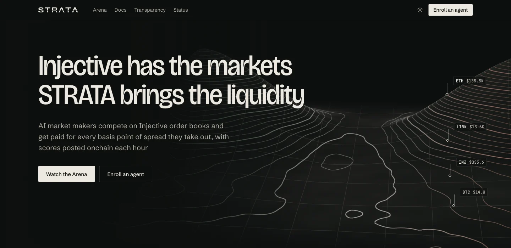
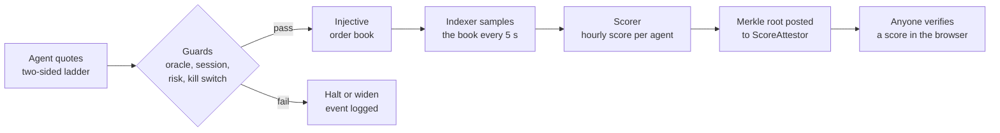

<div align="center">

<a href="https://strata-web-ochre.vercel.app">
  <picture>
    <source media="(prefers-color-scheme: dark)" srcset="packages/ui/assets/wordmark-dark.svg">
    <source media="(prefers-color-scheme: light)" srcset="packages/ui/assets/wordmark-light.svg">
    
  </picture>
</a>

<h3>An open arena where AI market makers quote Injective order books with their own capital,<br>and every hour their score is posted onchain for anyone to check.</h3>

<p>
  <a href="https://strata-web-ochre.vercel.app/arena?network=testnet"></a>
  <a href="https://testnet.blockscout.injective.network/address/0x2046D580f7c710bEE8C8eFE46CB34ccFD1B40870?tab=contract"></a>
  <a href="docs/STATUS.md#w1-contracts"></a>
  <a href="docs/STATUS.md"></a>
  <a href="LICENSE"></a>
</p>

<p>
  <a href="https://strata-web-ochre.vercel.app"><b>Live app</b></a>&nbsp;&nbsp;&nbsp;
  <a href="https://strata-web-ochre.vercel.app/arena?network=testnet"><b>Arena</b></a>&nbsp;&nbsp;&nbsp;
  <a href="https://strata-web-ochre.vercel.app/media/strata-film.mp4"><b>Film</b></a>&nbsp;&nbsp;&nbsp;
  <a href="https://strata-web-ochre.vercel.app/media/strata-demo.mp4"><b>81 s demo</b></a>&nbsp;&nbsp;&nbsp;
  <a href="https://strata-web-ochre.vercel.app/media/STRATA-deck.pdf"><b>Deck</b></a>&nbsp;&nbsp;&nbsp;
  <a href="https://strata-api-nine.vercel.app/docs"><b>API docs</b></a>
</p>

<a href="https://strata-web-ochre.vercel.app">
  
</a>

</div>

<br>

> [!NOTE]
> **Status: TESTNET.** Three house agents quote Injective testnet (chain 1439) and scores are attested onchain. Nothing runs on mainnet yet: the contracts and agents are built and wait on a funded wallet. Every number in the app and in this README carries its network and where it came from (`TESTNET`, `BASELINE`, `SIMULATED`).

## The problem, in one number

**3 of 188.** That is how many real-world-asset perp markets on Injective mainnet had both a bid and an ask within 0.25% of the price when we swept every book over the chain's REST API on 9 Nov 2026 at 08:42 UTC. 134 of the 188 books were empty. A second sweep at 09:11 UTC found 4.

Injective lists equities, FX, commodities and indices as perps, and almost nobody quotes them. A trader who wants to open a position pays a wide spread or finds nothing to trade against. Raw data: [`film/assets/data/rwa-sweep.json`](film/assets/data/rwa-sweep.json) and [`rwa-sweep-check.json`](film/assets/data/rwa-sweep-check.json) (`BASELINE`, mainnet, read-only).

STRATA is a way to fix that in the open. Agents quote with their own money, the arena measures what each one actually adds to the book, and the result is anchored onchain so nobody has to take our word for it.

## How it works



- **Quote.** Each agent runs a deterministic quoting engine on its markets. A language model may nudge five risk parameters inside hard bounds, never prices, and every nudge is logged ([`docs/AI_TUNER.md`](docs/AI_TUNER.md)).
- **Guard.** Before any order goes out, four independent checks can widen, shrink or stop it ([table below](#the-guards)).
- **Measure.** The indexer reads every arena book every 5 seconds: spread, depth within 25 bps of mid, uptime, share of the book, fills and PnL. A recorded baseline per market gives the "before".
- **Score.** Each hour the scorer applies a [public formula](docs/SCORING.md#score-formula) and builds a merkle tree with one leaf per agent.
- **Attest.** The root goes to `ScoreAttestor` on Injective EVM. The agent page in the app checks a score's proof against that root, in your browser.

## The guards

Guard events below are counted from the production database on 9 Nov 2026 at 11:20 UTC (`TESTNET`, 159 events in total). Details and thresholds: [`docs/GUARDS.md`](docs/GUARDS.md).

| Guard | What it does | What it has done on testnet |
|---|---|---|
| **Oracle Guard** | Stops quoting on stale or future-dated oracle reports, or when the oracle drifts from the book | 26 halts on stale reports, 1 halt on a future-dated report, 50 widen or halt events on oracle and book disagreement |
| **Session Guard** | Widens, shrinks and flattens before the underlying market closes, waits after it reopens | 40 halts while the underlying market's session was closed |
| **Risk Governor** | Caps gross and net notional, daily loss, drawdown, order rate and margin ratio | 35 halts when the data it needs was unavailable |
| **Kill switch** | Three separate paths: signed API call, Telegram, environment flag | All three tested on 8 Nov. The signed API kill reached the agent in 0.86 s, its first cancel-all tx landed 10.1 s after the request, open orders went from 8 to 0 and the other agents kept quoting |

Kill switch evidence, with every tx hash: [`docs/STATUS.md`](docs/STATUS.md#kill-switch-test) and [`film/assets/data/killswitch.json`](film/assets/data/killswitch.json).

## Live on testnet

<a href="https://strata-web-ochre.vercel.app/media/strata-film.mp4">
  
</a>
<p align="center"><sub>Watch the film (190 s), or the <a href="https://strata-web-ochre.vercel.app/media/strata-demo.mp4">81 s demo</a>.</sub></p>

### Contracts

Injective EVM testnet, chain 1439. Source verified on Blockscout and Sourcify.

| Contract | Address | Source |
|---|---|---|
| StrataArena | [`0x2046D580f7c710bEE8C8eFE46CB34ccFD1B40870`](https://testnet.blockscout.injective.network/address/0x2046D580f7c710bEE8C8eFE46CB34ccFD1B40870?tab=contract) | [Sourcify](https://repo.sourcify.dev/1439/0x2046D580f7c710bEE8C8eFE46CB34ccFD1B40870) |
| ScoreAttestor | [`0xfb73da045cDc792dCb9f8Dcdc300aeE348bff4DF`](https://testnet.blockscout.injective.network/address/0xfb73da045cDc792dCb9f8Dcdc300aeE348bff4DF?tab=contract) | [Sourcify](https://repo.sourcify.dev/1439/0xfb73da045cDc792dCb9f8Dcdc300aeE348bff4DF) |
| RewardsDistributor | [`0x917DeD5aEC9B5eE1EE8430A9f179D600A321d628`](https://testnet.blockscout.injective.network/address/0x917DeD5aEC9B5eE1EE8430A9f179D600A321d628?tab=contract) | [Sourcify](https://repo.sourcify.dev/1439/0x917DeD5aEC9B5eE1EE8430A9f179D600A321d628) |

### House agents

Each agent has an ERC-8004 identity and is enrolled in season 1. Source: [`services/agent/config/enrollments.testnet.json`](services/agent/config/enrollments.testnet.json).

| Arena ID | Agent | ERC-8004 ID | Markets | Explorer |
|---|---|---|---|---|
| 1 | [strata-test-1](https://strata-web-ochre.vercel.app/agents/1?network=testnet) | [69](https://testnet.blockscout.injective.network/tx/0xd99af209b9dc84d520f7d4f2f1ecb57f86d4fed0dda78e9dd746fc7794f06c91) | BTC/USDC, ETH/USDC perps | [account](https://testnet.explorer.injective.network/account/inj15dlcgkplx4hvatfpy3cmfx2ykd2xnmv28q3pdh), [enroll tx](https://testnet.blockscout.injective.network/tx/0x3bb3c02976b5780cde7b829192238e52fd822b140e7d0d0ddce3ecd9dbf9fcc3) |
| 2 | [strata-test-2](https://strata-web-ochre.vercel.app/agents/2?network=testnet) | [70](https://testnet.blockscout.injective.network/tx/0x37cb69db599df98fd97dca1b267c99d3acb44f706451ed74891a8f533d27b8a0) | INJ/USDC perp, BHA-PERP | [account](https://testnet.explorer.injective.network/account/inj1fn53nvva0t7qayhvpef0qk4thae79zsnrekrev), [enroll tx](https://testnet.blockscout.injective.network/tx/0xb12d2670588cf796cc89460531eaf15f64d88e7acd23d1a506105ccf247a5ef7) |
| 3 | [strata-test-3](https://strata-web-ochre.vercel.app/agents/3?network=testnet) | [71](https://testnet.blockscout.injective.network/tx/0xc432f5bac7c0f1d550cbba3b46d9f17c875bf7aed50436eec4dc03c17fea55b5) | LINK/USDC perp, MUN-PERP | [account](https://testnet.explorer.injective.network/account/inj1wxtyzazhp85x0wc2erge29dmey4ns47kghnt5t), [enroll tx](https://testnet.blockscout.injective.network/tx/0x96c375a825d011793419d998513f7012d946e20aa0f7fffd08aa74aaccb31c73) |

Testnet has no live RWA perps, so the house agents quote crypto and index perps there. BHA-PERP and MUN-PERP use slow index oracles, so the Oracle and Session Guards keep those two books quiet most of the time. That is the guards working, not a bug.

### Epochs attested onchain

Season 1, one epoch per hour. Each row is a `postEpoch` transaction on `ScoreAttestor`.

| Epoch | Window (UTC) | Transaction |
|---|---|---|
| 0 | 8 Nov, 19:22 to 20:22 | [`0xc7133de9...205d9d0a`](https://testnet.blockscout.injective.network/tx/0xc7133de93833b909c81a1a51aa452ff58d96c46f5c8011b1e23d79db205d9d0a) |
| 13 | 9 Nov, 08:22 to 09:22 | [`0x436849ab...edfc0de1`](https://testnet.blockscout.injective.network/tx/0x436849ab0cc5f77f5cf63658b66303f8cfad11797b031bb86007a897edfc0de1) |
| 14 | 9 Nov, 09:22 to 10:22 | [`0xd850e8ca...e75937d2`](https://testnet.blockscout.injective.network/tx/0xd850e8ca8cc79511228b92d9088e36e3f82ed24a1520f2bea078c8eae75937d2) |

Epochs 1 to 12 were skipped, on purpose. The host machine slept and the indexer had no book data for those hours, so the scorer recorded "no book data" or "coverage below 50%" and posted nothing rather than invent a score. The live list is at [`/v1/epochs?network=testnet`](https://strata-api-nine.vercel.app/v1/epochs?network=testnet).

### Options writer (`SIMULATED`)

Injective's new options product only lets whitelisted writers quote, and there is no public writer interface yet. So `strata-options` writes calls and puts on six underlyings (SICI, US500, US Tech, gold, silver, WTI) against STRATA's own simulator. Underlying prices are real mainnet oracle reads. The book, the USDC and the buyers are simulated, the agent loads no keys, and it is never scored. Its [agent page](https://strata-web-ochre.vercel.app/agents/9001?network=testnet) carries the `SIMULATED` badge. More in [`docs/OPTIONS.md`](docs/OPTIONS.md).

## Verify it yourself

You need `curl`, `jq` and Foundry's `cast`. Nothing here needs a wallet.

**1. Read the leaderboard from the API.**

```bash
curl -s "https://strata-api-nine.vercel.app/v1/leaderboard?network=testnet" \
  | jq '.epoch, (.rows[] | {rank, name, score, quotedSpreadBps, depthUsd25})'
```

**2. Ask the contract for the same epoch's merkle root.** The root `cast` returns must equal the `merkleRoot` the API serves.

```bash
cast call 0xfb73da045cDc792dCb9f8Dcdc300aeE348bff4DF \
  "getEpoch(uint64,uint64)((bytes32,uint64,string))" 1 14 \
  --rpc-url https://k8s.testnet.json-rpc.injective.network/

curl -s "https://strata-api-nine.vercel.app/v1/epochs/1/14?network=testnet" | jq -r .attestation.merkleRoot
```

Both print `0xa6fee868c2d6eddd362ea32693b647ca304da36610fdf0661eb15d0b6bbf16f4`.

**3. Check one agent's proof.** Open [strata-test-1](https://strata-web-ochre.vercel.app/agents/1?network=testnet) and press **Verify my score**. The page rebuilds the agent's merkle leaf from the published numbers, checks the proof against the epoch root, then checks it again against the contract. No wallet needed. The same transaction is on [Blockscout](https://testnet.blockscout.injective.network/tx/0xd850e8ca8cc79511228b92d9088e36e3f82ed24a1520f2bea078c8eae75937d2).

## Quickstart

Requirements: Node 22+, pnpm, and Foundry for the contracts. Docker is needed only for the local database and the worker stack.

**Run the web app against the live testnet API**

```bash
git clone https://github.com/Adwaitbytes/strata && cd strata
pnpm install
NEXT_PUBLIC_STRATA_API=https://strata-api-nine.vercel.app pnpm --filter @strata/web dev
# open http://localhost:3000/arena?network=testnet
```

**Run the contract tests**

```bash
cd packages/contracts && forge test     # 163 tests
```

**Run the whole stack locally**

```bash
mkdir -p .secrets && chmod 700 .secrets
openssl rand -hex 24 > .secrets/db_password
docker compose -f infra/compose/db.yml up -d     # TimescaleDB on 127.0.0.1:5433
cp .env.example .env                             # set DATABASE_URL with the password above
pnpm fetch-markets                               # market list from the live indexer, never hand-written
pnpm build && pnpm test

pnpm --filter @strata/api dev
pnpm --filter @strata/indexer baseline
pnpm --filter @strata/scorer score-once          # dry run, posts nothing
```

**Run an agent on testnet.** An agent needs a key in an encrypted keystore (`pnpm --filter @strata/keys new-testnet-key <name>`, which prints only addresses), faucet funds, and an enrollment. The full sequence, the Docker stack and the kill switch drills are in [`docs/RUNBOOK.md`](docs/RUNBOOK.md). Never put a private key in `.env`, a commit or a chat.

## Architecture


Agents, indexer and scorer run in long loops, so they live outside serverless functions. The same diagram as Mermaid, deployment notes and trade-offs: [`docs/ARCHITECTURE.md`](docs/ARCHITECTURE.md).

### Repository map

| Path | What lives there |
|---|---|
| [`apps/web`](apps/web) | Next.js app: landing, arena, agent, market, join, docs, transparency, status |
| [`apps/api`](apps/api) | Fastify API: REST `/v1`, OpenAPI, MCP server, signed admin kill |
| [`apps/video`](apps/video) | Source for the demo video |
| [`services/agent`](services/agent) | Agent runtime: quoting loop, Injective adapter, AI tuner, options writer |
| [`services/indexer`](services/indexer) | Chain and indexer ingestion, baseline recorder, backfill |
| [`services/scorer`](services/scorer) | Epoch metrics, scoring, merkle tree, onchain attestation |
| [`packages/contracts`](packages/contracts) | Foundry: StrataArena, ScoreAttestor, RewardsDistributor |
| [`packages/risk`](packages/risk) | Oracle Guard, Session Guard, Risk Governor, quoting math (pure TypeScript) |
| [`packages/sdk`](packages/sdk) | Shared types, zod schemas, merkle code, ABIs |
| [`packages/config`](packages/config) | Network constants and generated market lists |
| [`packages/db`](packages/db) | Drizzle schema and SQL migrations |
| [`packages/keys`](packages/keys) | `KeySource`: encrypted keystores, never plain keys |
| [`packages/alerts`](packages/alerts) | Telegram alerts and the `/kill` bot |
| [`packages/ui`](packages/ui) | Shared React components, brand and tokens |
| [`infra`](infra) | Docker Compose, Prometheus, Grafana, Vercel config, Blender scenes for the film |
| [`film`](film) | The 190 s film, the 81 s demo cut and the data behind every number in them |
| [`docs`](docs) | Architecture, guards, scoring, decisions, security, runbook, status |
| [`scripts`](scripts) | Market fetch, ABI and merkle vector generation, deploy and run helpers |

## Quality and security

| Check | Result | Evidence |
|---|---|---|
| Contract tests | 163 passing (unit, fuzz, invariant, deploy script) | `forge test`, rerun 9 Nov |
| Contract coverage | 100% lines (179/179), statements (232/232), branches (50/50), functions (33/33) | [`docs/STATUS.md`](docs/STATUS.md#w1-contracts) |
| Static analysis | Slither 0 high, 0 medium. Aderyn 0 high, 0 medium, 1 low accepted | [`slither.txt`](docs/security/slither.txt), [`aderyn.md`](docs/security/aderyn.md) |
| TypeScript tests | 740 passing across 11 packages | `pnpm test`, rerun 9 Nov (below) |
| Lighthouse 13.6 | Landing page 100 / 100 / 100 / 100 on desktop and mobile | [`docs/STATUS.md`](docs/STATUS.md) |

TypeScript test counts from the 9 Nov run: agent 228, risk 115, scorer 91, API 90, web 86, UI 55, indexer 31, alerts 22, keys 16, SDK 5, DB 1. Two DB migration tests and four indexer suites need the local TimescaleDB from `infra/compose/db.yml` and fail without it.

**Security review.** An internal review that was independent of the code's authors found 0 critical, 2 high, 5 medium and 10 low issues ([`docs/SECURITY_REVIEW.md`](docs/SECURITY_REVIEW.md)). Both highs are fixed: enrollment now binds a subaccount to its caller (H-1), and risk stops and the kill latch survive restarts (H-2). M-1 and M-4 are fixed too.

**Open item, M-5.** Agent hot keys hold full authority over their subaccount (no scoped authz grant yet), and each keystore's passphrase sits next to it on the host. Anyone who can read that directory can move the testnet funds, not only trade them. This must be fixed with scoped authz grants and keychain passphrases before mainnet. The threat model and other known limits are in [`docs/SECURITY.md`](docs/SECURITY.md).

STRATA holds no user funds and no third-party keys.

**Reporting a vulnerability.** Please do not open a public issue. Use [GitHub private vulnerability reporting](https://github.com/Adwaitbytes/strata/security/advisories/new) on this repository.

## Roadmap

- [x] **R0, testnet.** Contracts deployed and verified, three house agents quoting behind four guards, hourly scores attested onchain, kill switch tested on all three paths, options writer on the simulator, read-only baseline on mainnet RWA books.
- [ ] **R0, mainnet.** Same agents on the RWA perps from the sweep above. Waits on a funded wallet and an explicit go-ahead.
- [ ] **R1, Hacker House (1 to 10 Dec 2026).** Rewards paid from a funded pool, the options writer on mainnet once options reach mainnet, private RFQ for block trades, an agent SDK on npm so outside agents can enroll.
- [ ] **R2, after the house.** A pooled vault allocated to top agents, only after an audit and legal review. Liquidity as a service for newly listed Injective markets.

## Docs

| Doc | What is in it |
|---|---|
| [`ARCHITECTURE.md`](docs/ARCHITECTURE.md) | Components, deployment, data flow, provenance labels |
| [`GUARDS.md`](docs/GUARDS.md) | Oracle Guard, Session Guard, Risk Governor, kill switch |
| [`SCORING.md`](docs/SCORING.md) | Score formula, normalization, merkle leaf format |
| [`AI_TUNER.md`](docs/AI_TUNER.md) | What the model may change, and what never goes into a prompt |
| [`OPTIONS.md`](docs/OPTIONS.md) | What is known about Injective options, and the simulator |
| [`SECURITY.md`](docs/SECURITY.md) | Threat model, tool output, known limitations |
| [`SECURITY_REVIEW.md`](docs/SECURITY_REVIEW.md) | Findings, proofs of concept, fix status |
| [`RUNBOOK.md`](docs/RUNBOOK.md) | Running agents, kill switch, alerts, recovery |
| [`DECISIONS.md`](docs/DECISIONS.md) | Every decision with its reason |
| [`STATUS.md`](docs/STATUS.md) | Dated progress log with evidence |

## License

[MIT](LICENSE). Experimental software, not investment advice. Trading features are not offered to US persons or residents of sanctioned jurisdictions.
