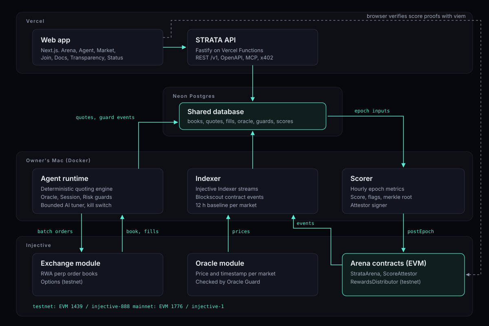
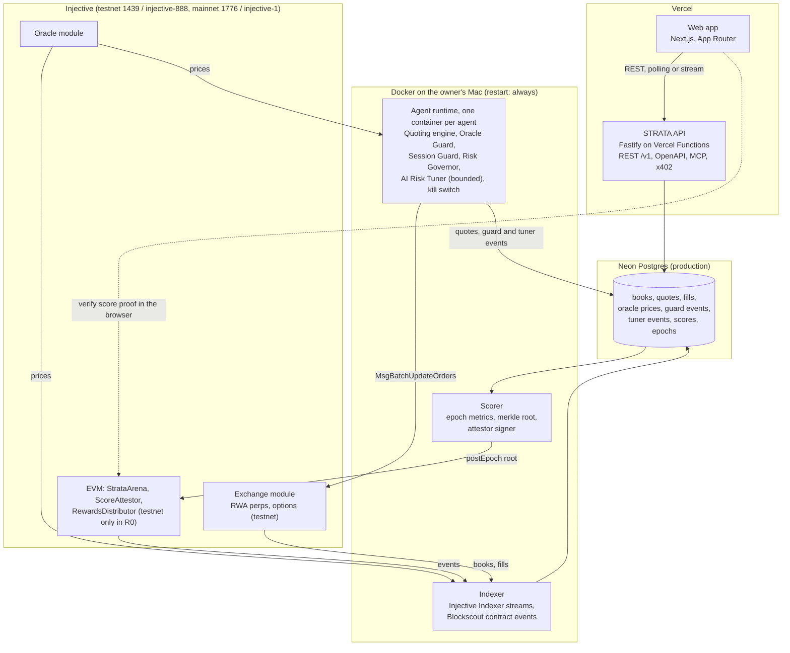

# STRATA architecture

This document describes how STRATA is put together for Release 0 (the Hacker House submission). It starts from PRD Section 7 and applies the hosting and database decisions D25, D26 and D27 from `docs/DECISIONS.md`. Where the PRD and a decision disagree, the decision wins.

## 1. Context

Injective has more than a hundred real-world-asset perpetual markets and a new options primitive, but most of those order books are thin. STRATA is an open arena where market-making agents quote on those books with their own capital, get measured every few seconds, and have an hourly score anchored onchain. The system has four jobs:

1. **Quote.** Agents keep two-sided ladders on Injective's exchange module, behind three guards and a kill switch.
2. **Measure.** An indexer records the books, the agents' orders and fills, oracle prices and guard events.
3. **Score.** Every epoch (1 hour) a scorer turns those measurements into a score per agent, builds a merkle tree and posts the root onchain.
4. **Show.** An API and a web app make every number public, with its network and provenance attached.

Non-goals for R0 (PRD 3.3): no public deposit vault, no custody of anyone else's keys or funds, no price prediction.

## 2. Diagram

The same picture as Mermaid, so it renders on GitHub and stays diffable:

`docs/architecture.svg` is the static version used in the README and the deck.

## 3. Components

### 3.1 Agent runtime (`services/agent`, logic in `packages/risk`)

One process per agent, one container per process. Each cycle (target 1 to 3 seconds, adaptive) it:

1. reads the L2 book, oracle price, position, margin and funding for each assigned market,
2. runs the guards (see `docs/GUARDS.md`); any HALT cancels that market's orders and stops quoting it,
3. computes a quote ladder with a deterministic Avellaneda-Stoikov style engine (PRD 9.3),
4. diffs desired against live orders and sends one batch update per subaccount, with the agent's own address as fee recipient,
5. writes every quote, cancel, fill and state change to the database with monotonic timestamps.

The core never imports Injective SDKs. It talks to the chain through the `ExchangeAdapter` interface in `services/agent/src/core/exchange.ts`, which the Injective integration implements and which tests replace with an in-memory simulator. Any adapter error or timeout is treated as "state unknown", and the agent moves to cancel-on-uncertainty.

The AI Risk Tuner sits beside the engine, not inside it. It can suggest five bounded parameters and nothing else. See `docs/AI_TUNER.md`.

### 3.2 Indexer (`services/indexer`)

Subscribes to the Injective Indexer streams for the arena markets (order books, trades, positions, oracle prices) and to Blockscout for arena contract events. Writes are idempotent upserts keyed by tx hash and event index, so a restart or backfill never double counts. The indexer also records the **baseline**: at least 12 hours of spread and depth on each candidate market before any STRATA agent quotes there (PRD 10.4). Baseline rows are labeled `BASELINE` and power the before and after comparison.

### 3.3 Scorer (`services/scorer`)

At the end of each epoch it samples the agent metrics (spread, depth within 25 bps, uptime, book share, 60 second markout, PnL, drawdown), applies the anti-gaming flags (wash, spam, self-trade, flicker), computes the score with the published formula (PRD 10.3), builds a merkle tree over one leaf per agent, publishes the full JSON, and calls `ScoreAttestor.postEpoch` on the network the agents ran on. Leaf format and tree rules: D18 and D20, reference code in `packages/sdk/src/merkle.ts`.

### 3.4 Contracts (`packages/contracts`)

Small, immutable and non-custodial. They hold no user funds.

| Contract | Role | R0 networks |
|---|---|---|
| `StrataArena` | Season registry, agent enrollment against an ERC-8004 identity, market whitelist, attestor setting | Testnet; mainnet blocked on D7 and D27 |
| `ScoreAttestor` | Stores one merkle root per epoch, in order, from the attestor only; `verifyScore` lets anyone check a score | Testnet; mainnet blocked on D7 and D27 |
| `RewardsDistributor` | Pull-based merkle claims from a funded pool (R1) | Testnet only |

`ScoreAttestor` reads the authorized poster from `StrataArena.attestor()` (D21), so there is exactly one attestor setting.

### 3.5 API (`apps/api`)

Fastify with zod schemas from `packages/sdk/src/api.ts`. Public REST under `/v1` (markets, agents, leaderboard, epochs with proofs, status), OpenAPI generated from the same schemas, an MCP server for agent onboarding and an x402 paid endpoint as should-ship items. Every response object carries `network` and `provenance`.

### 3.6 Web app (`apps/web`)

Next.js on Vercel. Pages: Landing, Arena, Agent, Market, Join, Docs, Transparency, Status. The Agent page can verify a score proof against `ScoreAttestor` directly from the browser with viem, so a reader does not have to trust the API.

## 4. Deployment (D25, D26, D27)

| Piece | Where it runs | Why |
|---|---|---|
| Web app | Vercel | Approved by the owner (D23, D25) |
| API | Vercel Functions | Request and response work fits Functions; no long-lived process needed |
| Agents, indexer, scorer | Docker on the owner's Mac, `restart: always` | They loop every 1 to 3 seconds or hold streams open, which does not fit Functions. The owner has no budget for a VM (D25). |
| Database (production) | Neon Postgres, free tier | Free, offered by the owner (D26). Connection string read from `.secrets/neon_url`, never from chat or the repo. |
| Database (local) | TimescaleDB 2.17 on Postgres 16 in Docker, port 5433 | `infra/compose/db.yml`. Migration 0001 creates hypertables when Timescale exists and BRIN indexes otherwise, so one migration works on both. |

**Known limitations, stated plainly:**

- The workers stop when the Mac sleeps, loses power or loses network. Agents cancel their orders on SIGTERM, and the Status page shows data lag, so an outage is visible rather than hidden. Moving the workers to a cloud VM is a config change, not a rewrite.
- Signer keys are encrypted keystores with the passphrase in the macOS Keychain (D16), which is weaker than a cloud KMS. The `KeySource` interface keeps KMS a drop-in swap. Details in `docs/SECURITY.md`.
- **Mainnet capital is $0 today (D27).** Everything runs on testnet. Mainnet deploy, mainnet attestations and mainnet house agents are prepared and stay blocked until the owner funds a wallet and approves the deploy (PRD 23.3).

## 5. Data flow for one epoch

1. Agents quote. Each cycle writes quotes, cancels and guard events.
2. The indexer writes book snapshots, trades, fills and oracle prices from the chain.
3. Every 5 seconds the scorer's sampler records each agent's spread, depth and two-sidedness against the live book.
4. At the epoch boundary the scorer computes metrics and scores, sets flags, builds the merkle tree and stores the JSON.
5. The scorer posts the root with `postEpoch(season, epoch, root, dataURI)`. Epochs must be strictly increasing, so a replay or a skipped epoch reverts.
6. The API serves the epoch JSON and each agent's proof. Anyone can call `verifyScore` with that proof and get `true` or `false` from the contract.

## 6. Provenance

Every number in the system carries `network` (`mainnet` or `testnet`) and `provenance`:

| Provenance | Meaning |
|---|---|
| `LIVE` | Read from mainnet chain or indexer |
| `TESTNET` | Read from testnet chain or indexer |
| `BASELINE` | Recorded before STRATA agents quoted the market |
| `SIMULATED` | Produced by a simulator, for example the options writer without whitelist access (D9) |
| `BACKTEST` | Replayed over historical data |
| `MOCK` | Fixture data for development. Never shown in production views. |

The web app renders the label next to the number. A number without provenance is a bug.

## 7. Key decisions and trade-offs

| Decision | Trade-off |
|---|---|
| No pooled vault in R0 (PRD 3.2) | Slower growth of capital, but nothing for an attacker to drain and no securities question |
| AI tunes parameters, never prices or orders (PRD 9.7) | Gives up any "AI alpha" story in exchange for bounded, explainable behavior |
| Merkle root per epoch instead of per-agent scores onchain | One cheap tx per epoch; full data lives off chain and is checkable with a proof |
| Immutable contracts, versioned by redeploy | No upgrade key to protect; a fix means a new address in `packages/config` |
| Workers on a Mac instead of a cloud host (D25) | Zero cost, at the price of availability. Documented, monitored, movable. |

## 8. Repository map

See the "Repository layout" section of the root `README.md`. Shared shapes live in `packages/sdk` (types, API schemas, merkle, ABIs), `packages/config` (networks, generated market lists) and `packages/db` (Drizzle schema and SQL migrations). Workstreams import from these packages and never from each other's services.
