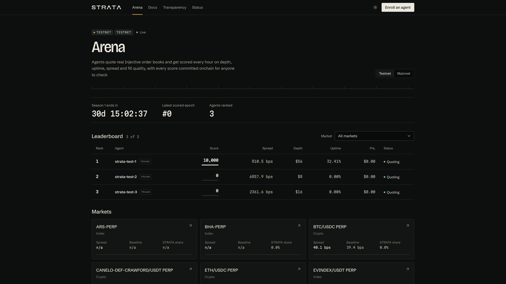

# Build kit: how every scene in this film is written

Read `SPEC.md` first (look, objects, motion, shots, DATA, banned list). This file is the mechanics. The project root is `film/` (run every command from there). HyperFrames CLI is pinned: `npx --yes hyperframes@0.9.26 <command>`.

## Files you own
Only `compositions/<your-scene>.html` for the scenes you were given (and, if you truly need one, a new still under `assets/<your-scene>/`). Never edit `index.html`, `SPEC.md`, `KIT.md`, `cues.json`, `compositions/captions.html`, other scenes, `assets/data/*`, `assets/video/*` or anything under `assets/screens`. The host for your scene already exists in `index.html` with the right `data-start` and `data-duration`. Do not render the full film. Do not commit.

## Skeleton (copy it)
```html
<template>
  <style>
    @font-face { font-family: "Bricolage Grotesque"; src: url("assets/fonts/BricolageGrotesque-latin.woff2") format("woff2"); font-weight: 200 800; font-stretch: 75% 100%; font-style: normal; }
    @font-face { font-family: "Schibsted Grotesk"; src: url("assets/fonts/SchibstedGrotesk-latin.woff2") format("woff2"); font-weight: 400 900; font-style: normal; }
    @font-face { font-family: "Martian Mono"; src: url("assets/fonts/MartianMono-latin.woff2") format("woff2"); font-weight: 100 800; font-stretch: 75% 112.5%; font-style: normal; }
    #root { position: absolute; inset: 0; overflow: hidden; background: #0D0F0E; }
    /* every id and class is prefixed with the scene id: #gap-cam, .gap-label ... */
    .SCENE-display { font-family: "Bricolage Grotesque", sans-serif; font-weight: 480; font-stretch: 92%; font-variation-settings: "opsz" 96; letter-spacing: -0.027em; line-height: 0.98; }
    .SCENE-mono { font-family: "Martian Mono", monospace; font-stretch: 87.5%; font-feature-settings: "tnum" 1, "zero" 1; }
    .SCENE-body { font-family: "Schibsted Grotesk", sans-serif; }
  </style>
  <div id="root" data-composition-id="SCENE" data-width="1920" data-height="1080" data-duration="DUR">
    <!-- timed children: class="clip" data-start data-duration data-track-index, a stable id -->
  </div>
  <script>
    const tl = gsap.timeline({ paused: true });
    // tl.fromTo(...) only (never .from); positions are LOCAL seconds from 0
    window.__timelines["SCENE"] = tl;
  </script>
</template>
```
- `SCENE` and `DUR` come from `cues.json` (`scenes[].scene`, `.duration`). Times inside a scene are local (0 = the scene's start).
- The narration is already placed in `index.html`. `cues.json` gives each spoken word's LOCAL time `t` (and `end`) inside your scene. Land a reveal 0 to 0.15 s BEFORE the word that names it. Hard-code those numbers; never read files at runtime (no fetch, no `Date`, no `Math.random`, no timers, no `repeat: -1`).
- Never tween `display`/`visibility` on a `.clip`; animate a child or its opacity. Do not put a CSS `transform` on an element GSAP transforms: set its start inside `fromTo`. GSAP is global (the host loads it).
- Every timed element ends inside the scene: `data-start + data-duration <= DUR`. Land end states at least 0.2 s before the scene ends; the last 0.3 s is settled.
- Text >= 28 px after any camera scale. Content inside x 96 to 1824, y 54 to 900. **y > 900 is the caption band: never put anything there** (`check` flags it).
- Colours, type and sizes: only the values in `SPEC.md` LOOK. One accent word per title, coloured, never italic.

## Blender shots (full-bleed video)
`assets/video/b1.mp4` ... `b7.mp4` (B1 8 s, B2 7 s, B3 9 s, B4 5 s, B5 6 s, B6 10 s, B7 6 s; 1920 x 1080, 30 fps). Right now they are labelled placeholders of the exact length; the lead swaps in the real renders at the same paths, so build against them as if they were the land. Overlay positions that depend on the render (the canyon's x, the ochre layer's y) go in one JS constant at the top of your script so the lead can retune them in one place.
```html
<video id="SCENE-b2" class="clip" src="assets/video/b2.mp4" muted playsinline data-start="0" data-duration="7" data-track-index="0"
  style="position:absolute;left:0;top:0;width:1920px;height:1080px;object-fit:cover"></video>
```
- Never play, pause or seek media in script. To hold a frame (the halt freeze), stop showing the video and show the still the lead exports at `assets/video/b4-freeze.jpg` (placeholder exists) as an `` clip.
- To slow a shot, `data-playback-rate` (0.85 to 1.0 only).

## Real screens and the camera
Captures in `assets/screens/*.png` and `assets/screens/chain/*.png` are 3840 x 2160 PNGs of a 1920 x 1080 page at DPR 2. `assets/screens/boxes.json` and `assets/screens/chain/boxes.json` hold measured CSS-pixel boxes of key elements per capture (confirm by viewing the PNG). Read `film/SPEC.md` BANNED: never show the site footer, the agent page "Live quotes" panel, the tuner card's "APPLIED" badge, or Blockscout's "Blocks Indexed" banner (frame them out).

```html
<div id="SCENE-cam" class="clip" data-start="0" data-duration="DUR" data-track-index="1" style="position:absolute;left:0;top:0;width:1920px;height:1080px;transform-origin:0 0">
  
</div>
```
Camera to a region (CSS px of the page), centred; scale up to 2.0 (captures stay sharp up to 2x):
```js
const frame = (x, y, w, h, max = 2) => {
  const s = Math.min(max, 1920 / w, 900 / h);           // 900: keep the region above the caption band
  return { scale: s, x: (1920 - w * s) / 2 - x * s, y: (900 - h * s) / 2 - y * s };
};
tl.set("#SCENE-cam", { x: 0, y: 0, scale: 1 }, 0);
tl.to("#SCENE-cam", { ...frame(348, 504, 1224, 260), duration: 1.1, ease: "power2.inOut" }, 3.7);
```
Hold still while the viewer reads; move again on the next cue. When you rebuild a component at large size (allowed, it reads better than an upscale), copy its exact text and values from the capture and `SPEC.md` DATA, in the site's own style: instrument panel `#121513` with a 1 px `#373D39` border and two corner ticks, radius 4 px, mono labels in `#B4AFA3`, values in `#ECE8DF`.

## Titles
Each word its own span (`<span class="SCENE-w">word</span>`), then:
```js
tl.fromTo("#SCENE-title .SCENE-w", { opacity: 0, filter: "blur(8px)" }, { opacity: 1, filter: "blur(0px)", duration: 0.18, stagger: 0.08, ease: "power2.out" }, t);
```
Exit: `tl.to("#SCENE-title", { opacity: 0, filter: "blur(6px)", duration: 0.2, ease: "power3.in" }, t2)`. Landed titles never move.

## Rolling digits (mono numbers)
Build each digit as a column `<span class="SCENE-col"><span>0</span>...<span>9</span></span>` inside an `overflow:hidden` cell one line tall, and tween the column's `y` to `-digit * lineHeight` with `power3.out` 0.6 s, digits 0.04 s apart. Punctuation (`,` `.` `$` `%` letters) are plain spans.

## Survey drawing (SVG)
Lines and profiles are inline SVG paths you compute once in script at build time (deterministic, from hard-coded numbers you copied from `assets/data/*.json`), and draw in with `strokeDasharray`/`strokeDashoffset` tweens. Hairline strokes 1.5 to 2 px; index lines 3 px.

## Check your work (required before you report)
From `film/`:
- `npx --yes hyperframes@0.9.26 lint` (0 errors in your files) and `npx --yes hyperframes@0.9.26 check --json` (fix every error and every warning about your scene except ones caused by placeholders).
- `npx --yes hyperframes@0.9.26 snapshot --composition SCENE --at <local seconds, comma separated>` at every cue moment plus 0.1 and DUR-0.15, then LOOK at the images it writes (Read the .jpg/.png). Check: text >= 28 px, nothing clipped or overlapping, nothing in the caption band, the frame reads as the shot in `SPEC.md`, no empty dark void. Fix, snapshot again.
- Report: what each beat shows (with local times), the snapshot paths, any deviation from SPEC and why, and the LOCAL times of visible events that deserve a sound (a click, a number landing, a rung vanishing, a freeze), so the lead can place effects.
